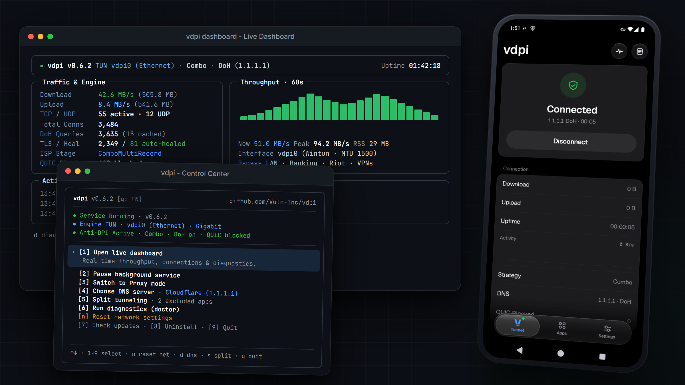
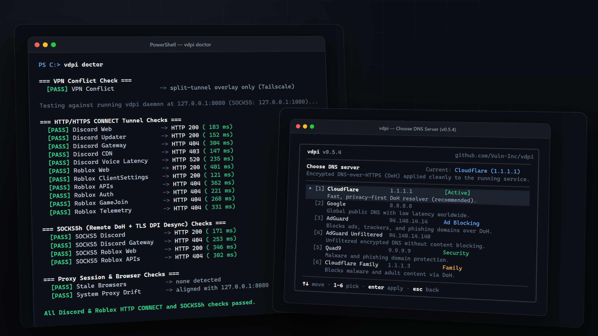
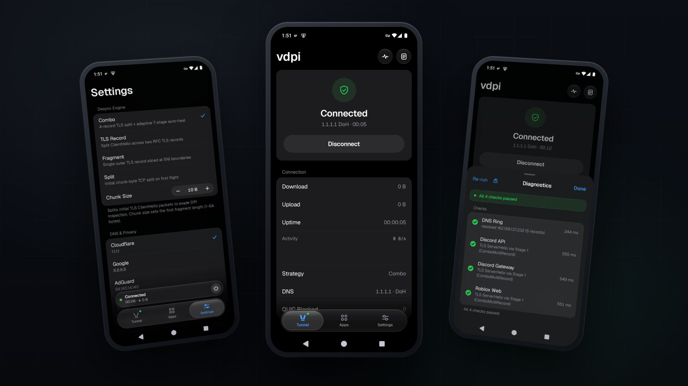

<div align="center">

# `vdpi`

Self-healing anti-DPI engine in Rust, native across Windows, macOS, Linux, Android, and iOS.  
Runs as a transparent system-wide TUN adapter or a lightweight local proxy with zero remote servers and zero telemetry.

[](https://github.com/Vuln-Inc/vdpi/releases/latest)
[](./LICENSE)
[](#quick-install)

[Quick Install](#quick-install) · [Engines](#engine-modes-proxy-vs-tun) · [Getting Started](#getting-started) · [Docs](#documentation) · [Releases](https://github.com/Vuln-Inc/vdpi/releases/latest) · [Changelog](./CHANGELOG.md) · [Security](./SECURITY.md)

</div>

<p align="center">
  
</p>

<p align="center">
  
  
</p>

---

## Highlights

<table>
  <tr>
    <td valign="top" width="50%">
      <strong>Two desktop engines (TUN + Proxy)</strong><br>
      Transparent system-wide TUN (<code>Wintun</code> / <code>utun</code> / <code>/dev/net/tun</code>, zero proxy env edits or browser restarts) or classic lightweight local HTTP/SOCKS5 proxy (no virtual adapter, portable) - 1-press switchable.
    </td>
    <td valign="top" width="50%">
      <strong>Native across all 5 platforms</strong><br>
      Single self-contained binary on Windows, macOS, and Linux, plus zero-root local VPN apps for Android (APK) and iOS/iPadOS (IPA) sharing the same Rust core.
    </td>
  </tr>
  <tr>
    <td valign="top" width="50%">
      <strong>Zero-hassle &amp; lightweight</strong><br>
      Self-healing 7-stage adaptive TLS desync engine, anti-poisoning RFC 8484 DoH ring, UDP/443 QUIC blocking, ~10-20 MB RAM, and crash-proof OS teardown.
    </td>
    <td valign="top" width="50%">
      <strong>VPN, audio &amp; gaming safe</strong><br>
      Gigabit TUN with zero-audio-stutter thread budgeting (VoiceMeeter safe), auto-yields to Mullvad, WireGuard, OpenVPN, ProtonVPN, and WARP and auto-resumes; coexists with Tailscale, Docker, and LAN; embedded WHQL-signed Wintun (anticheat safe) and low-latency UDP NAT for Discord, Roblox, and games.
    </td>
  </tr>
  <tr>
    <td valign="top" width="50%">
      <strong>Control Center TUI</strong><br>
      Interactive <code>ratatui</code> launcher with <strong>Open live dashboard</strong> (<code>l</code>, attach live without restarting), <strong>Choose DNS server</strong> (<code>d</code>, presets + <code>[7] Custom DNS</code> IP/DoH picker), per-app <strong>Split tunneling</strong> picker (<code>s</code>, fuzzy search + Include/Exclude), SHA-256-verified self-updater (<code>vdpi update</code>), and <code>config.toml</code> persistence.
    </td>
    <td valign="top" width="50%">
      <strong>Local-only &amp; verifiable</strong><br>
      All traffic stays on-device with no remote relay servers or analytics. Every release asset is verified against <code>SHA256SUMS.txt</code> (see <a href="https://github.com/Vuln-Inc/vdpi/blob/main/SECURITY.md#binary-verification">SECURITY.md</a>).
    </td>
  </tr>
</table>

---

## Quick Install

### Windows (`x86_64`, Windows 10 & 11)

```powershell
# PowerShell one-liner (SHA-256 verified)
irm https://vuln-inc.github.io/vdpi/install.ps1 | iex

# Scoop (direct manifest, no extra bucket required)
scoop install https://vuln-inc.github.io/vdpi/vdpi.json

# WinGet
winget install Vuln-Inc.vdpi

# Cargo (https://crates.io/crates/vdpi)
cargo install vdpi
```

> **Note:** Official Windows releases ship as a single standalone `vdpi.exe` with the pinned WHQL-signed Wintun `0.14.1` driver embedded directly inside the binary (no loose `wintun.dll` required). `cargo install vdpi` builds `vdpi.exe` without the embedded driver (Proxy mode works immediately; for TUN mode, place `wintun.dll` beside `vdpi.exe` or install via Scoop, WinGet, or `install.ps1`).

Direct download: [`vdpi-windows-x86_64.zip`](https://github.com/Vuln-Inc/vdpi/releases/latest/download/vdpi-windows-x86_64.zip) (single standalone `vdpi.exe` with embedded WHQL-signed Wintun `0.14.1`) or [crates.io/crates/vdpi](https://crates.io/crates/vdpi).

### macOS & Linux (`universal` / `x86_64` & `arm64`)

```bash
# Shell one-liner (macOS & Linux, SHA-256 verified)
curl -fsSL https://vuln-inc.github.io/vdpi/install.sh | sh

# Cargo (https://crates.io/crates/vdpi)
cargo install vdpi
```

Direct downloads: [`vdpi-macos-universal.tar.gz`](https://github.com/Vuln-Inc/vdpi/releases/latest/download/vdpi-macos-universal.tar.gz) · [`vdpi-linux-x86_64.tar.gz`](https://github.com/Vuln-Inc/vdpi/releases/latest/download/vdpi-linux-x86_64.tar.gz) · [`vdpi-linux-arm64.tar.gz`](https://github.com/Vuln-Inc/vdpi/releases/latest/download/vdpi-linux-arm64.tar.gz) (static `musl`).

### Android (`8.0+`, `arm64-v8a` / `armeabi-v7a` / `x86_64`)

- Download the signed universal APK: [`vdpi-android-universal.apk`](https://github.com/Vuln-Inc/vdpi/releases/latest/download/vdpi-android-universal.apk)
- Track automatic updates with [Obtainium](https://github.com/ImranR98/Obtainium) using `https://github.com/Vuln-Inc/vdpi`
- Open **vdpi**, tap **Connect**, and run **Diagnostics** to verify DoH and TLS bypass.

### iOS / iPadOS (`16+`, `arm64`)

- **AltStore / SideStore / Feather source URL:**
  ```text
  https://vuln-inc.github.io/vdpi/apps.json
  ```
- **TrollStore / Sideloadly / paid signer:** download [`vdpi-ios-unsigned.ipa`](https://github.com/Vuln-Inc/vdpi/releases/latest/download/vdpi-ios-unsigned.ipa) (requires TrollStore or a paid Apple Developer certificate with `NetworkExtension` entitlements; free Apple IDs cannot sign `packet-tunnel-provider`).

---

## Engine Modes (Proxy vs TUN)

- **Proxy mode (default):** Zero admin privileges required, zero virtual adapter, routing table, or DNS changes, and most stable out of the box for browsers, Discord, Telegram, and apps that honor system proxy.
- **TUN mode (system-wide):** Captures all TCP & UDP traffic including games (Roblox, Valorant, etc.) and apps that ignore system proxy.
- **How to switch:** Open the `vdpi` Control Center (`vdpi` with no args) and select **Switch to TUN** / **Switch to Proxy** (automatically prompts for UAC on Windows or `sudo` / Touch ID password on macOS & Linux - no need to pre-run as root), or run `vdpi install --tun` / `vdpi --tun`.

| Dimension | Proxy Mode (`--proxy`, **Default**) | TUN Mode (`--tun`) |
| :--- | :--- | :--- |
| **Traffic capture** | Local `127.0.0.1:8080` (HTTP/HTTPS/SOCKS5/4a) + `:1080` (SOCKS5 TCP/UDP) | Layer 3 virtual NIC (`Wintun` / `utun` / `/dev/net/tun`) + userspace stack |
| **App coverage** | Browsers, Discord, Telegram & apps honoring system proxy or `HTTP_PROXY` / `HTTPS_PROXY` | System-wide TCP & UDP: games (Roblox, Valorant, etc.), Discord voice, CLI, all apps |
| **OS integration** | Sets OS proxy & env vars; no virtual adapter, route, or DNS changes | Zero proxy env edits; no browser restart required |
| **Privileges & memory** | Zero admin privileges required; ~8-14 MB RAM | Prompts for UAC (Windows) or `sudo` / Touch ID (macOS & Linux); ~16-22 MB RAM |
| **VPN & anticheat** | Pure loopback proxy; no virtual adapter; `VpnGuard` auto-yield | `VpnGuard` 0ms auto-yield; WHQL-signed Wintun (anticheat safe) |

### Switching Modes

Your current mode (`Proxy` or `TUN`) is always shown in the `Engine` row of the `vdpi` Control Center and in the Live Dashboard status bar.

- **Interactive TUI:** Run `vdpi` with no args and select **Switch to TUN** / **Switch to Proxy** - `vdpi` automatically prompts for elevation (UAC on Windows, `sudo` / Touch ID password on macOS & Linux; no need to pre-run as root).
- **CLI:**
  ```bash
  vdpi engine         # Show current engine mode (Proxy or TUN)
  vdpi engine tun     # Switch to transparent system-wide TUN mode
  vdpi engine proxy   # Switch back to default local HTTP/SOCKS5 proxy mode
  vdpi install --tun  # Install background service directly in TUN mode
  vdpi --tun          # Launch or run in TUN mode
  vdpi --tun start    # Run a one-off foreground TUN session
  vdpi --proxy start  # Run a one-off foreground Proxy session
  ```

For anti-DPI framing modes (`--mode combo` default with 7-stage self-healing auto-escalation, `tls-record`, `split`, `oob`, `disorder`), see [Engine Modes](docs/engines.md) and [CLI Reference](docs/cli.md).

---

## Getting Started

```bash
vdpi              # Open the Control Center TUI (`l` Open live dashboard, `s` Split tunneling, switch engine)
vdpi dashboard    # Attach the live throughput & telemetry dashboard to the running background service
vdpi split        # Open the per-app Split tunneling picker (alias `vdpi apps`; `--split-mode`, `--split-app`)
vdpi engine tun   # Switch desktop engine to TUN mode (or `vdpi engine proxy`)
vdpi pause        # Temporarily pause the background service (`vdpi resume` to re-enable)
vdpi doctor       # Run live end-to-end DPI bypass and DoH diagnostics
vdpi update       # Check, SHA-256 verify, and upgrade in place
```

Run `vdpi install` to register automatic background startup (Windows Service, macOS `LaunchDaemon` / `LaunchAgent`, or Linux `systemd`), `vdpi start` for a foreground session with a live throughput sparkline dashboard, or `vdpi uninstall` to remove all files and restore OS network settings.

---

## Documentation

| Guide | Contents |
| :--- | :--- |
| [Engine Modes (TUN vs Proxy)](docs/engines.md) | Platform TUN architecture, Proxy OS integration, 7-stage adaptive TLS engine |
| [VPN Coexistence & Custom Bypass](docs/vpn-and-bypass.md) | `VpnGuard` auto-yield, Tailscale/Docker/LAN safety, `--bypass` & `--include` rules |
| [CLI & config.toml Reference](docs/cli.md) | All commands, global flags, precedence rules, and full `config.toml` schema |
| [Diagnostics & Troubleshooting](docs/diagnostics.md) | `vdpi status`, `vdpi doctor`, Defender/antivirus notes, recovery steps |
| [Building from Source](docs/building.md) | Workspace crate layout and build steps for Desktop, Android APK, and iOS IPA |

---

## License

Released under the [MIT License](./LICENSE) · [Changelog](./CHANGELOG.md) · [Security](./SECURITY.md) · Official repository: [github.com/Vuln-Inc/vdpi](https://github.com/Vuln-Inc/vdpi) · Copyright (c) 2026 [Vuln-Inc](https://github.com/Vuln-Inc).  
Official Windows release binaries embed the unmodified WHQL-signed Wintun `0.14.1` driver (Copyright (C) WireGuard LLC, distributed under the Wintun / GPLv2 license - see [wintun.net](https://www.wintun.net/)).
