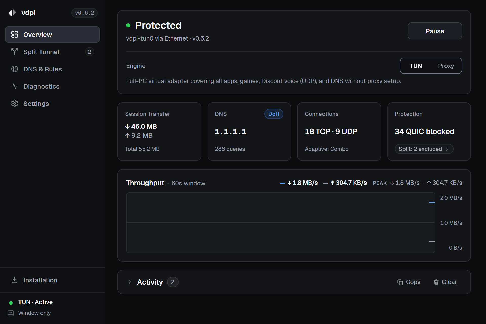
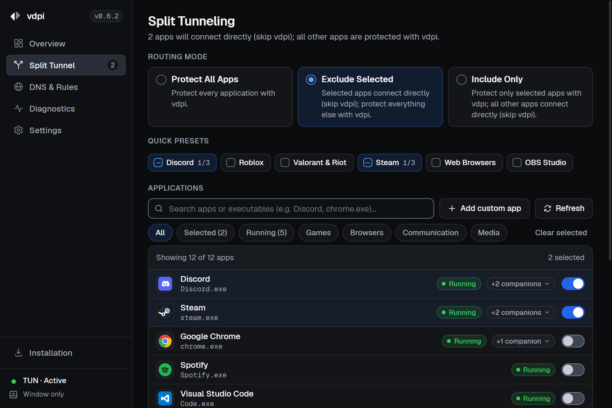
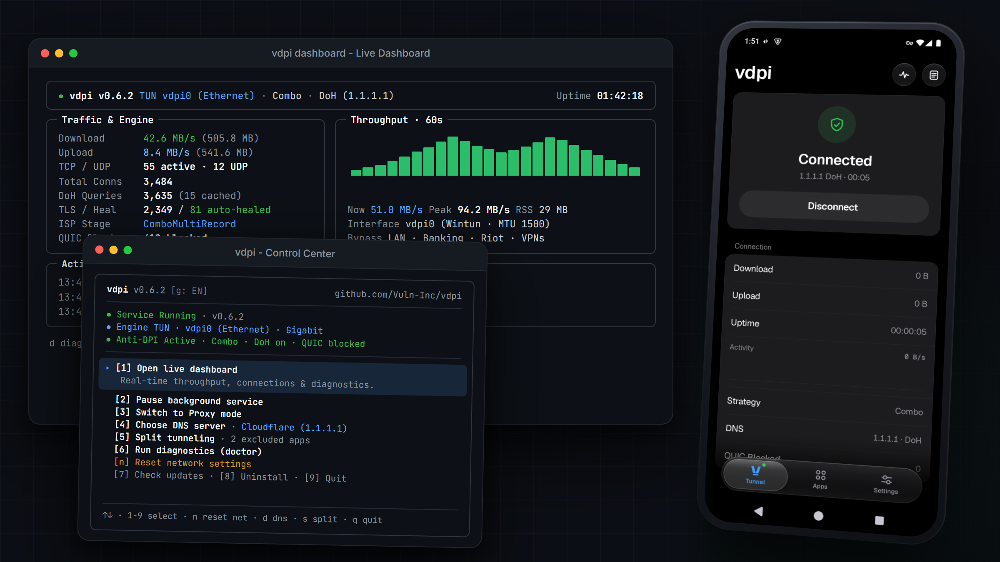
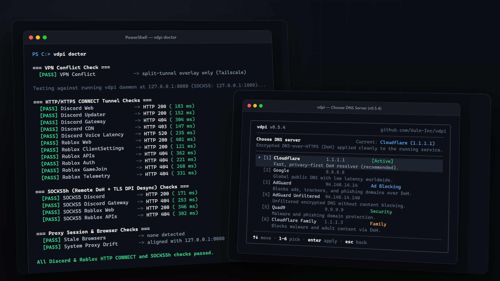
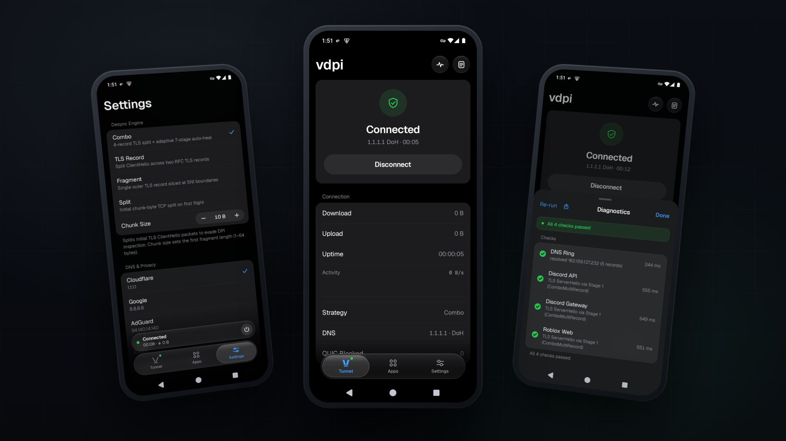

<div align="center">

[English](./README.md) · **Türkçe**

# `vdpi`

Rust ile yazılmış, kendi kendini uyarlayan anti-DPI motoru; Windows, macOS, Linux, Android ve iOS üzerinde yerel olarak çalışır.  
Yerel Masaüstü Arayüzü (GUI), etkileşimli Kontrol Merkezi TUI ve root gerektirmeyen mobil uygulamalarla gelir - uzak sunucu ve telemetri olmadan şeffaf sistem geneli TUN bağdaştırıcısı veya hafif yerel vekil sunucu (Proxy) olarak çalışır.

[](https://github.com/Vuln-Inc/vdpi/releases/latest)
[](./LICENSE)
[](#hızlı-kurulum)

[Hızlı Kurulum](#hızlı-kurulum) · [Motor Modları](#motor-modları-proxy-ve-tun) · [Başlarken](#başlarken) · [Belgeler](#belgeler) · [Sürümler](https://github.com/Vuln-Inc/vdpi/releases/latest) · [Değişiklik Günlüğü](./CHANGELOG.md) · [Güvenlik](./SECURITY.md)

</div>

<p align="center">
  
  
</p>

<p align="center">
  
</p>

<p align="center">
  
  
</p>

---

## Öne Çıkanlar

<table>
  <tr>
    <td valign="top" width="50%">
      <strong>Yerel Masaüstü Uygulaması (GUI)</strong><br>
      Windows, macOS ve Linux için hafif yerel uygulama: canlı 60 saniyelik aktarım hızı grafiği, tek tıkla TUN/Proxy geçişi, görsel uygulama bazlı Bölünmüş Tünel (Discord, Roblox, Valorant &amp; Riot, Steam, tarayıcılar ve OBS için hızlı şablonlar + eşlikçi süreç gruplama), DNS ve alan adı kuralları, Tanılama ve sistem tepsisi / menü çubuğu denetimleri.
    </td>
    <td valign="top" width="50%">
      <strong>İki masaüstü motoru (TUN + Proxy)</strong><br>
      Şeffaf sistem geneli TUN (<code>Wintun</code> / <code>utun</code> / <code>/dev/net/tun</code>; ortam değişkeni düzenlemesi veya tarayıcı yeniden başlatması gerekmez) ya da hafif yerel HTTP/SOCKS5 proxy (sanal bağdaştırıcı olmadan taşınabilir) - tek tıkla veya tek tuşla geçiş.
    </td>
  </tr>
  <tr>
    <td valign="top" width="50%">
      <strong>5 platformda yerel çalışma</strong><br>
      Windows, macOS ve Linux için yerel Masaüstü GUI paketleri ve hafif CLI ikilileri, ayrıca aynı Rust çekirdeğini paylaşan root gerektirmeyen Android (APK) ve iOS/iPadOS (IPA) yerel VPN uygulamaları.
    </td>
    <td valign="top" width="50%">
      <strong>Türkçe ve İngilizce (<code>English</code>) dil desteği</strong><br>
      Masaüstü GUI, Kontrol Merkezi TUI, Android ve iOS genelinde tam Türkçe ve İngilizce arayüz - sistem dilini otomatik algılar, istendiğinde Ayarlar veya <code>config.toml</code> üzerinden değiştirilebilir.
    </td>
  </tr>
  <tr>
    <td valign="top" width="50%">
      <strong>Zahmetsiz ve hafif</strong><br>
      7 aşamalı kendini uyarlayan TLS desync motoru, DNS zehirlenmesine karşı RFC 8484 DoH halkası, UDP/443 QUIC engelleme, ~10-20 MB RAM tüketimi ve çökme durumunda bile işletim sistemi ağ ayarlarını güvenle geri yükleme.
    </td>
    <td valign="top" width="50%">
      <strong>VPN, ses ve oyunlarla uyumlu</strong><br>
      Seste takılma yapmayan iş parçacığı bütçeli Gigabit TUN (VoiceMeeter uyumlu); Mullvad, WireGuard, OpenVPN, ProtonVPN ve WARP algılandığında otomatik duraklar ve VPN kapanınca kaldığı yerden devam eder; Tailscale, Docker ve yerel ağla birlikte çalışır; WHQL imzalı Wintun (anti-cheat uyumlu) ve Discord, Roblox ile oyunlar için düşük gecikmeli UDP NAT.
    </td>
  </tr>
  <tr>
    <td valign="top" width="50%">
      <strong>Kontrol Merkezi TUI</strong><br>
      Etkileşimli <code>ratatui</code> arayüzü: <strong>Canlı gösterge paneli</strong> (<code>l</code>, yeniden başlatmadan canlı bağlan), <strong>DNS sunucusu seç</strong> (<code>d</code>, hazır sunucular + <code>[7] Özel DNS</code> IP/DoH seçici), uygulama bazlı <strong>Bölünmüş tünel</strong> seçicisi (<code>s</code>, bulanık arama + Dahil Et/Hariç Tut), SHA-256 doğrulamalı güncelleyici (<code>vdpi update</code>) ve <code>config.toml</code> kalıcılığı.
    </td>
    <td valign="top" width="50%">
      <strong>Tamamen yerel ve doğrulanabilir</strong><br>
      Tüm trafik cihaz içinde kalır; uzak aktarım sunucusu veya analitik yoktur. Her sürüm dosyası <code>SHA256SUMS.txt</code> ile doğrulanabilir (ayrıntılar için <a href="https://github.com/Vuln-Inc/vdpi/blob/main/SECURITY.md#binary-verification">SECURITY.md</a>).
    </td>
  </tr>
</table>

---

## Hızlı Kurulum

### Hangi Sürümü İndirmeliyim?

`vdpi`, aynı yerel Rust motorunu ve `config.toml` dosyasını paylaşan üç sürümle gelir - kullanım şeklinize uygun olanı seçin (çoğu masaüstü kullanıcısı için yalnızca **Masaüstü Uygulaması** yeterlidir):

| Sürüm | Kimler için? | Sürüm dosya adı | İçindekiler |
| :--- | :--- | :--- | :--- |
| **Masaüstü Uygulaması (GUI)** *(Önerilen)* | Çoğu Windows, macOS ve Linux kullanıcısı | `vdpi-desktop-*` (`.zip`, `.dmg`, `.deb`, `.AppImage`) | Yerel uygulama penceresi, sistem tepsisi, görsel Bölünmüş Tünel, DNS/Tanılama **ve** paketli `vdpi` motoru ile `wintun.dll` |
| **Terminal / TUI (CLI)** | Terminal kullanıcıları, betikler, arayüzsüz veya ARM64 Linux | `vdpi-*` (`.zip`, `.tar.gz`) | Hafif terminal Kontrol Merkezi TUI ve arka plan servisi CLI ikilisi (pencere arayüzü yok) |
| **Mobil** | Telefon ve tabletler | `vdpi-android-*.apk`, `vdpi-ios-*.ipa` | Android `8.0+` ve iOS/iPadOS `16+` için root gerektirmeyen yerel VPN uygulaması |

> **İpucu:** **Masaüstü Uygulaması (GUI)** indirirseniz Terminal / TUI arşivini ayrıca indirmenize gerek yoktur - her şey paket içinde hazırdır.

### Masaüstü Uygulaması (GUI) - Windows, macOS ve Linux

**Windows (`x86_64`, Windows 10 ve 11 - taşınabilir, kurulum sihirbazı yok):**

```powershell
# PowerShell tek satır kurulum (SHA-256 doğrulamalı taşınabilir kurulum + Başlat Menüsü kısayolu)
irm https://vuln-inc.github.io/vdpi/install-desktop.ps1 | iex

# Scoop (ek depo gerekmeden doğrudan bildirim)
scoop install https://vuln-inc.github.io/vdpi/vdpi-desktop.json

# WinGet (inceleme bekliyor: microsoft/winget-pkgs#491533)
winget install Vuln-Inc.vdpi.Desktop
```

Doğrudan indirme: [`vdpi-desktop-windows-x86_64-portable.zip`](https://github.com/Vuln-Inc/vdpi/releases/latest/download/vdpi-desktop-windows-x86_64-portable.zip) (arşivi çıkarıp `vdpi-desktop.exe` dosyasını çalıştırın).

**macOS (Evrensel, Apple Silicon ve Intel):**

```bash
# Homebrew Cask (ek depo gerekmeden doğrudan tap)
brew tap vuln-inc/vdpi https://github.com/Vuln-Inc/vdpi
brew install --cask vuln-inc/vdpi/vdpi-desktop
```

Doğrudan indirme: [`vdpi-desktop-macos-universal.dmg`](https://github.com/Vuln-Inc/vdpi/releases/latest/download/vdpi-desktop-macos-universal.dmg) (DMG dosyasını açıp Uygulamalar klasörüne sürükleyin).

**Linux (`x86_64` - Debian/Ubuntu, Arch, AppImage, Flatpak):**

```bash
# Kabuk tek satır kurulum (Debian/Ubuntu üzerinde .deb, diğer dağıtımlarda AppImage - SHA-256 doğrulamalı)
curl -fsSL https://vuln-inc.github.io/vdpi/install-desktop.sh | sh

# Arch Linux (depo içi PKGBUILD)
git clone --depth 1 https://github.com/Vuln-Inc/vdpi.git && cd vdpi/packaging/aur/vdpi-desktop-bin && makepkg -si
```

Doğrudan indirmeler: [`vdpi-desktop-linux-x86_64.deb`](https://github.com/Vuln-Inc/vdpi/releases/latest/download/vdpi-desktop-linux-x86_64.deb) (Debian/Ubuntu) · [`vdpi-desktop-linux-x86_64.AppImage`](https://github.com/Vuln-Inc/vdpi/releases/latest/download/vdpi-desktop-linux-x86_64.AppImage) (tüm dağıtımlar, [AppImageHub PR #12747](https://github.com/AppImage/appimage.github.io/pull/12747)) · [Flatpak bildirimi](./packaging/flatpak/README.md).

> **Not:** Masaüstü GUI paketleri `vdpi` motor dosyasını (Windows üzerinde ayrıca değiştirilmemiş WHQL imzalı `wintun.dll` `0.14.1` sürücüsünü) içinde barındırır, sistem tepsisi / menü çubuğu ile bütünleşir ve Terminal / TUI sürümüyle aynı `config.toml` yapılandırmasını ve arka plan servisini paylaşır.

### Terminal / TUI (CLI) - Windows (`x86_64`, Windows 10 ve 11)

```powershell
# PowerShell tek satır kurulum (SHA-256 doğrulamalı)
irm https://vuln-inc.github.io/vdpi/install.ps1 | iex

# Scoop (ek depo gerekmeden doğrudan bildirim)
scoop install https://vuln-inc.github.io/vdpi/vdpi.json

# WinGet (inceleme bekliyor: microsoft/winget-pkgs#489148)
winget install Vuln-Inc.vdpi

# Cargo / cargo-binstall (https://crates.io/crates/vdpi)
cargo binstall vdpi
cargo install vdpi
```

> **Not:** Resmi Windows CLI arşivleri (`vdpi-windows-x86_64.zip`), `vdpi.exe` dosyasının yanında değiştirilmemiş WHQL imzalı `wintun.dll` (`0.14.1`) ve `WINTUN-LICENSE.txt` dosyalarını içerir (yalnızca TUN modu için gerekir). Proxy modu Windows (`AutoConfigURL`), macOS (`AutoProxyURL`) ve Linux (GNOME/KDE PAC; Linux tarafında `--no-env-proxy` verilmedikçe kullanıcı oturumu `HTTP_PROXY`/`HTTPS_PROXY` değişkenleri de dışa aktarılır) üzerinde açık-kalma (fail-open) özellikli `/vdpi.pac` kullanır; böylece Windows veya macOS üzerinde `vdpi` kapansa ya da çökse bile doğrudan internet erişimi kesilmez. `cargo install vdpi` Proxy modunda hemen çalışır; Windows üzerinde TUN modu için uyumlu sürüm arşivindeki `wintun.dll` dosyasını `vdpi.exe` yanına kopyalayın.

Doğrudan indirme: [`vdpi-windows-x86_64.zip`](https://github.com/Vuln-Inc/vdpi/releases/latest/download/vdpi-windows-x86_64.zip) (`vdpi.exe`, WHQL imzalı `wintun.dll` `0.14.1` ve `WINTUN-LICENSE.txt`) veya [crates.io/crates/vdpi](https://crates.io/crates/vdpi).

### Terminal / TUI (CLI) - macOS ve Linux (`universal` / `x86_64` ve `arm64`)

```bash
# Kabuk tek satır kurulum (macOS ve Linux, SHA-256 doğrulamalı)
curl -fsSL https://vuln-inc.github.io/vdpi/install.sh | sh

# Homebrew (macOS Evrensel ve Linux x86_64/arm64)
brew tap vuln-inc/vdpi https://github.com/Vuln-Inc/vdpi
brew install vuln-inc/vdpi/vdpi

# Nix Flake (Linux ve macOS)
nix run github:Vuln-Inc/vdpi
nix profile install github:Vuln-Inc/vdpi

# Arch Linux (depo içi PKGBUILD)
git clone --depth 1 https://github.com/Vuln-Inc/vdpi.git && cd vdpi/packaging/aur/vdpi-bin && makepkg -si

# Cargo / cargo-binstall (https://crates.io/crates/vdpi)
cargo binstall vdpi
cargo install vdpi
```

Doğrudan indirmeler: [`vdpi-macos-universal.tar.gz`](https://github.com/Vuln-Inc/vdpi/releases/latest/download/vdpi-macos-universal.tar.gz) · [`vdpi-linux-x86_64.tar.gz`](https://github.com/Vuln-Inc/vdpi/releases/latest/download/vdpi-linux-x86_64.tar.gz) · [`vdpi-linux-arm64.tar.gz`](https://github.com/Vuln-Inc/vdpi/releases/latest/download/vdpi-linux-arm64.tar.gz) (statik `musl`) · [İndirme portalı](https://vuln-inc.github.io/vdpi/).

### Android (`8.0+`, `arm64-v8a` / `armeabi-v7a` / `x86_64`)

- İmzalı evrensel APK dosyasını indirin: [`vdpi-android-universal.apk`](https://github.com/Vuln-Inc/vdpi/releases/latest/download/vdpi-android-universal.apk)
- [Obtainium](https://github.com/ImranR98/Obtainium) üzerinde `https://github.com/Vuln-Inc/vdpi` adresini ekleyerek güncellemeleri otomatik takip edebilirsiniz.
- **vdpi** uygulamasını açın, **Bağlan** düğmesine dokunun ve DoH ile TLS atlatmayı doğrulamak için **Tanılama** çalıştırın.

### iOS / iPadOS (`16+`, `arm64`)

- **AltStore / SideStore / Feather kaynak adresi:**
  ```text
  https://vuln-inc.github.io/vdpi/apps.json
  ```
- **TrollStore / Sideloadly / ücretli imzalama:** [`vdpi-ios-unsigned.ipa`](https://github.com/Vuln-Inc/vdpi/releases/latest/download/vdpi-ios-unsigned.ipa) dosyasını indirin (TrollStore veya `NetworkExtension` yetkilendirmeli ücretli Apple Developer sertifikası gerekir; ücretsiz Apple ID hesapları `packet-tunnel-provider` imzalayamaz).

---

## Motor Modları (Proxy ve TUN)

- **Proxy modu (varsayılan):** Taşınabilir ve ön plan çalıştırmalarında yönetici izni gerektirmez (macOS/Linux üzerinde arka plan servisi de yetkisiz çalışır; yalnızca Windows Servisi kurulumu Yönetici izni ister). Sanal bağdaştırıcı, yönlendirme tablosu veya DNS değişikliği yapmaz; tarayıcılar, Discord, Telegram ve sistem proxy ayarını kullanan uygulamalar için varsayılan olarak en kararlı seçenektir.
- **TUN modu (sistem geneli):** Oyunlar (Roblox, Valorant vb.) ve sistem proxy ayarını yok sayan uygulamalar dahil tüm TCP ve UDP trafiğini yakalar.
- **Nasıl geçiş yapılır:** Masaüstü GUI Genel Bakış ekranında **TUN / Proxy** anahtarını kullanın, `vdpi` Kontrol Merkezi'ni (`vdpi` argümansız) açıp **TUN moduna geç** / **Proxy moduna geç** seçeneğini seçin (Windows'ta UAC, macOS ve Linux'ta `sudo` / Touch ID / `pkexec` yetki istemini otomatik açar - önceden root olarak başlatmanız gerekmez) veya `vdpi install --tun` / `vdpi --tun` komutunu çalıştırın.

| Özellik | Proxy Modu (`--proxy`, **Varsayılan**) | TUN Modu (`--tun`) |
| :--- | :--- | :--- |
| **Trafik yakalama** | Yerel `127.0.0.1:8080` (HTTP/HTTPS/SOCKS5/4a) + `:1080` (SOCKS5 TCP/UDP) | Katman 3 sanal ağ kartı (`Wintun` / `utun` / `/dev/net/tun`) + kullanıcı alanı yığını |
| **Uygulama kapsamı** | Tarayıcılar, Discord, Telegram ve işletim sistemi açık-kalma PAC (`/vdpi.pac`) ya da yerel proxy dinleyicilerini kullanan uygulamalar | Sistem geneli TCP ve UDP: oyunlar (Roblox, Valorant vb.), Discord sesli sohbet, CLI ve tüm uygulamalar |
| **İşletim sistemi bütünleşmesi** | Açık-kalma `/vdpi.pac` otomatik yapılandırma (Windows `AutoConfigURL` ve macOS `AutoProxyURL`, ortam değişkeni olmadan; Linux GNOME/KDE PAC ve isteğe bağlı `systemd --user` ortam değişkenleri, `--no-env-proxy` ile kapatılabilir); sanal bağdaştırıcı, yönlendirme veya DNS değişikliği yok | Proxy düzenlemesi yok; tarayıcıyı yeniden başlatmak gerekmez |
| **Yetkiler ve bellek** | Taşınabilir/ön plan için yönetici izni gerekmez (macOS/Linux servisi yetkisiz; yalnızca Windows Servisi kurulumu Yönetici ister); ~8-14 MB RAM | Windows'ta UAC, macOS ve Linux'ta `sudo` / Touch ID / `pkexec` ister; ~16-22 MB RAM |
| **VPN ve anti-cheat** | Saf loopback proxy; sanal bağdaştırıcı yok; `VpnGuard` otomatik duraklatma | `VpnGuard` 0ms otomatik duraklatma; WHQL imzalı Wintun (anti-cheat uyumlu) |

### Modlar Arasında Geçiş

Etkin motor modu (`Proxy` veya `TUN`), Masaüstü GUI Genel Bakış ve kenar çubuğunda, `vdpi` Kontrol Merkezi'nin `Motor` satırında ve Canlı Gösterge Paneli durum çubuğunda her zaman görünür.

- **Masaüstü GUI:** Motoru anında değiştirmek için Genel Bakış üst bilgisindeki **TUN** veya **Proxy** düğmesine tıklayın.
- **Etkileşimli TUI:** Argümansız `vdpi` çalıştırın ve **TUN moduna geç** / **Proxy moduna geç** seçeneğini seçin - `vdpi` yetki yükseltmeyi otomatik ister (Windows'ta UAC, macOS ve Linux'ta `sudo` / Touch ID).
- **CLI:**
  ```bash
  vdpi engine         # Etkin motor modunu göster (Proxy veya TUN)
  vdpi engine tun     # Şeffaf sistem geneli TUN moduna geç
  vdpi engine proxy   # Varsayılan yerel HTTP/SOCKS5 proxy moduna dön
  vdpi install --tun  # Arka plan servisini doğrudan TUN modunda kur
  vdpi --tun          # TUN modunda başlat veya çalıştır
  vdpi --tun start    # Tek seferlik ön plan TUN oturumu başlat
  vdpi --proxy start  # Tek seferlik ön plan Proxy oturumu başlat
  ```

Anti-DPI paketleme modları (7 aşamalı kendini uyarlayan varsayılan `--mode combo`, `tls-record`, `fragment`, `split`) için [Motor Modları](docs/engines.md) (İngilizce) ve [CLI Başvuru Kılavuzu](docs/cli.md) (İngilizce) belgelerine bakın.

---

## Dil Desteği

`vdpi`, Masaüstü GUI, Kontrol Merkezi TUI, Android ve iOS genelinde **Türkçe** ve **İngilizce** dillerini destekler.

- **Otomatik algılama:** Varsayılan olarak işletim sistemi dilini izler; sistem diliniz Türkçe ise Türkçe, aksi durumda İngilizce açılır.
- **Elle seçim:** Dili istediğiniz zaman **Ayarlar** (Masaüstü GUI, Android ve iOS), Kontrol Merkezi TUI veya `config.toml` içindeki `language` anahtarı (`"auto"`, `"en"` veya `"tr"`) üzerinden değiştirebilirsiniz.

---

## Başlarken

Grafik arayüz için **vdpi Desktop** uygulamasını açın veya doğrudan CLI ve Kontrol Merkezi TUI komutlarını kullanın:

```bash
vdpi              # Kontrol Merkezi TUI'yi aç (`l` canlı panel, `d` DNS seçici, `s` Bölünmüş tünel, motor geçişi)
vdpi dashboard    # Çalışan arka plan servisine canlı hız ve telemetri panelini bağla
vdpi dns          # Üst DNS / DoH sunucusunu göster veya değiştir (ör. `vdpi dns cloudflare`, `vdpi dns 94.140.14.14`)
vdpi split        # Uygulama bazlı Bölünmüş tünel seçicisini aç (takma ad `vdpi apps`; `--split-mode`, `--split-app`)
vdpi engine tun   # Masaüstü motorunu TUN moduna geçir (veya `vdpi engine proxy`)
vdpi pause        # Arka plan servisini geçici olarak duraklat (yeniden etkinleştirmek için `vdpi resume`)
vdpi doctor       # Uçtan uca canlı DPI atlatma ve DoH tanılama testlerini çalıştır
vdpi update       # Yeni sürümü denetle, SHA-256 doğrula ve yerinde güncelle
```

Otomatik arka plan başlatma kaydı için `vdpi install` (Windows Servisi, macOS `LaunchDaemon` / `LaunchAgent` veya Linux `systemd`), canlı aktarım grafiğiyle ön plan oturumu için `vdpi start`, tüm dosyaları kaldırıp işletim sistemi ağ ayarlarını geri yüklemek için `vdpi uninstall` komutunu kullanın.

---

## Belgeler

| Rehber | İçerik |
| :--- | :--- |
| [Motor Modları (TUN ve Proxy)](docs/engines.md) (İngilizce) | Platform TUN mimarisi, Proxy OS bütünleşmesi, 7 aşamalı uyarlanabilir TLS motoru |
| [VPN Uyumluluğu ve Özel Atlatma](docs/vpn-and-bypass.md) (İngilizce) | `VpnGuard` otomatik duraklatma, Tailscale/Docker/LAN güvenliği, `--bypass` ve `--include` kuralları |
| [CLI ve config.toml Başvuru Kılavuzu](docs/cli.md) (İngilizce) | Tüm komutlar, genel bayraklar, öncelik kuralları ve tam `config.toml` şeması |
| [Tanılama ve Sorun Giderme](docs/diagnostics.md) (İngilizce) | `vdpi status`, `vdpi doctor`, Defender/antivirüs notları ve kurtarma adımları |
| [Kaynaktan Derleme](docs/building.md) (İngilizce) | Çalışma alanı paket yapısı ve Masaüstü, Android APK ile iOS IPA derleme adımları |

---

## Lisans

[MIT Lisansı](./LICENSE) altında yayımlanmıştır · [Değişiklik Günlüğü](./CHANGELOG.md) · [Güvenlik](./SECURITY.md) · Resmi depo: [github.com/Vuln-Inc/vdpi](https://github.com/Vuln-Inc/vdpi) · Telif Hakkı (c) 2026 [Vuln-Inc](https://github.com/Vuln-Inc).  
Resmi Windows sürüm arşivleri değiştirilmemiş WHQL imzalı Wintun `0.14.1` sürücüsünü içerir (`wintun.dll` ve `WINTUN-LICENSE.txt`, Telif Hakkı (C) WireGuard LLC, Wintun / GPLv2 lisansı altında dağıtılır - bkz. [wintun.net](https://www.wintun.net/)).
